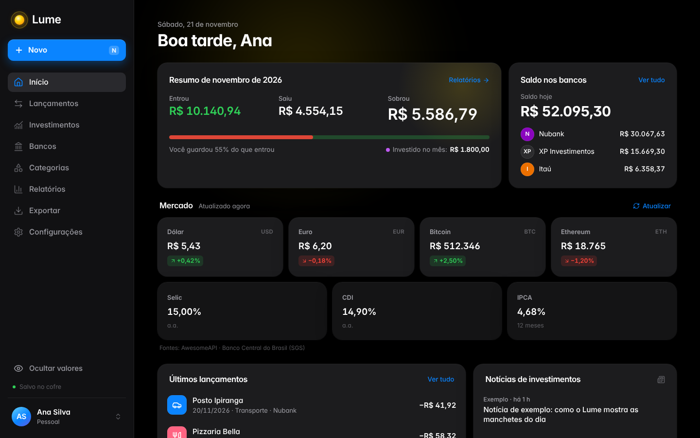
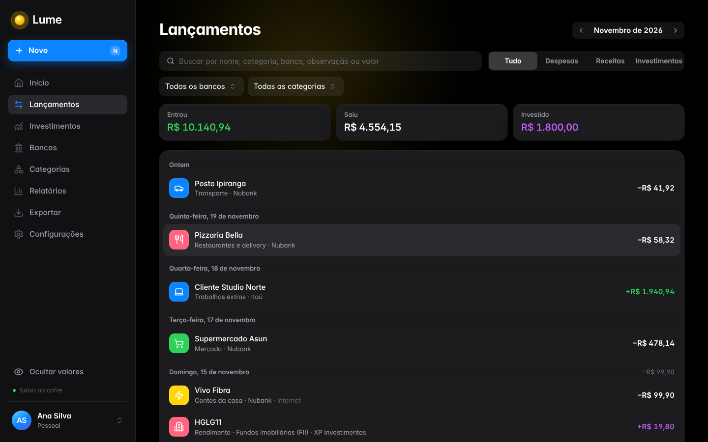
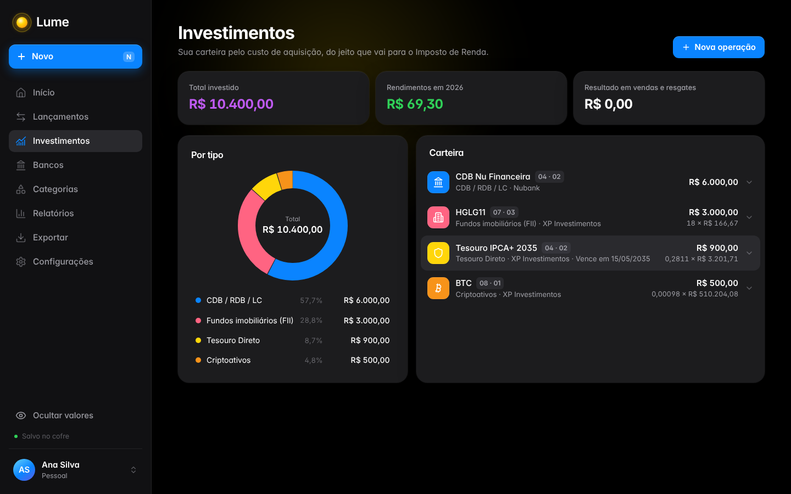
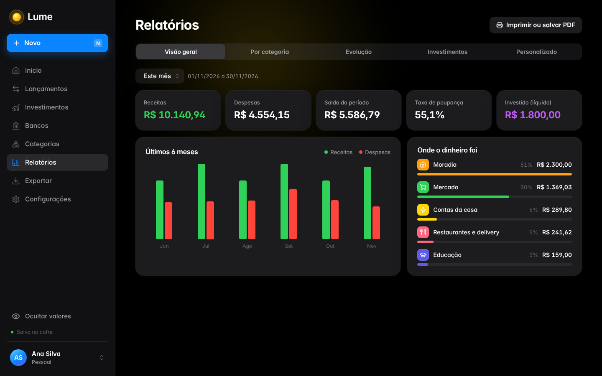
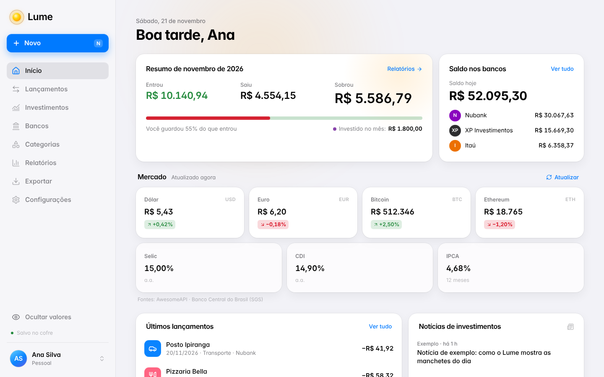
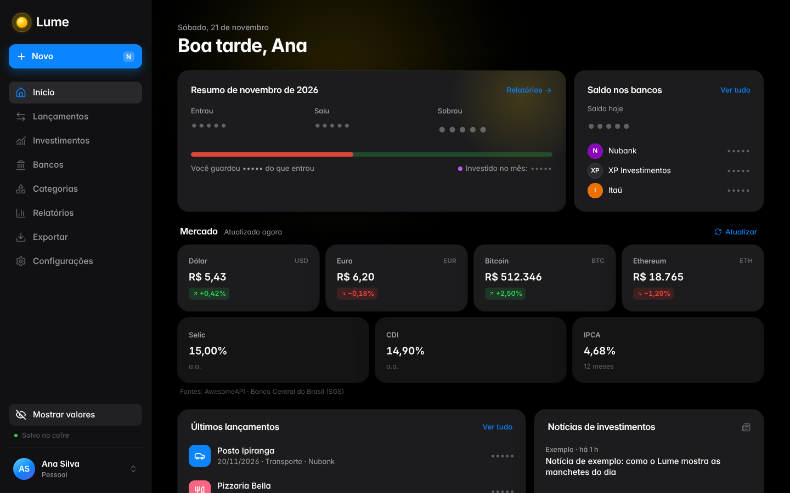
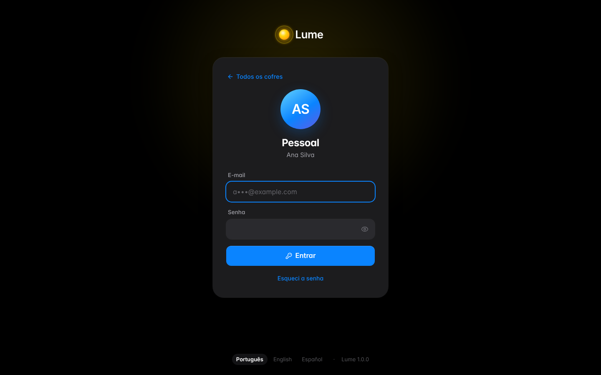

<div align="center">


# Lume

**Suas finanças, com clareza.**

App de finanças pessoais de código aberto que roda **no seu computador**.
A interface abre no navegador, e os dados ficam em arquivos seus, sem nuvem e sem conta online.

[](https://github.com/guilhermehenn/lume/releases/latest)
[](LICENSE)
[](#instalação)
[](https://github.com/guilhermehenn/lume/actions/workflows/ci.yml)

[Instalação](#instalação) · [Funcionalidades](#funcionalidades) · [Documentação](docs/README.md) · [Contribuir](CONTRIBUTING.md) · [Segurança](SECURITY.md)



</div>

> **In English:** Lume is an open-source personal finance app that runs locally on Windows and
> macOS, with a browser-based interface and data stored in local SQLite files ("vaults"). It is
> built for Brazil (Brazilian banks, income tax reports, BRL), and the interface is available in
> Portuguese, English and Spanish. See [Instalação](#instalação) for setup; the technical
> documentation is in Portuguese in [`docs/`](docs/README.md).

---

## Sumário

- [Por que o Lume](#por-que-o-lume)
- [Funcionalidades](#funcionalidades)
- [Telas](#telas)
- [Instalação](#instalação)
- [Primeiro uso](#primeiro-uso)
- [Seus dados e backups](#seus-dados-e-backups)
- [Privacidade e segurança](#privacidade-e-segurança)
- [Desenvolvimento](#desenvolvimento)
- [Documentação](#documentação)
- [Roteiro](#roteiro)
- [Como contribuir](#como-contribuir)
- [Licença](#licença)
- [Agradecimentos](#agradecimentos)

## Por que o Lume

- **Seus dados, no seu computador.** Cada "cofre" é um arquivo SQLite numa pasta sua. Não há
  servidor do Lume, conta online nem anúncios.
- **Pensado para o Brasil.** Traz os principais bancos brasileiros já cadastrados, investimentos
  com o Grupo e o Código da ficha Bens e Direitos e um pacote em Excel para o contador.
- **Não perde dados.** Faz um backup verificado por dia e outro antes de qualquer operação que
  troque tudo (restaurar, apagar, atualizar). Excluir um lançamento, um banco ou uma categoria
  pode ser desfeito na hora.
- **Bonito e rápido.** A interface é limpa, com tema escuro e claro, e se ajusta a janelas
  estreitas. Foi testada com cofres de 100 mil lançamentos.

## Funcionalidades

| Área | O que tem |
|---|---|
| **Início** | Resumo do mês (entrou, saiu, sobrou), saldo de hoje e o previsto, dólar, euro, Bitcoin, Ethereum, Selic, CDI e IPCA, notícias de investimentos, últimos e próximos lançamentos. |
| **Lançamentos** | Despesas, receitas e investimentos numa lista por dia, com filtros por tipo, banco e categoria, e busca sem acento (inclusive pelo valor) em todos os meses. |
| **Novo lançamento** | Valor digitado como no app do banco, sugestões de nomes já usados, "Salvar e criar outro", atalhos Hoje/Ontem e Desfazer. |
| **Investimentos** | 16 tipos (CDB, LCI/LCA, Tesouro, ações, FII, ETF, BDR, fundos, previdência, cripto…), carteira pelo custo médio, rendimentos, resultado em vendas e o código do IR de cada ativo. |
| **Bancos e categorias** | 18 bancos e 24 categorias prontos, saldo por banco, junção de bancos e troca de categoria sem perder lançamentos. |
| **Relatórios** | Visão geral, por categoria, evolução de 12 meses, investimentos para o IR e relatório personalizado com filtros salvos. Todos imprimem ou viram PDF. |
| **Exportar** | Pacote para o contador (.xlsx), CSVs, relatório anual e backup (.json) de tudo, com envio opcional pelo seu próprio e-mail. |
| **Cofres** | Vários cofres independentes (você, a casa, a empresa), cada um com dono, e-mail, senha e código de recuperação. |
| **Configurações** | Português, inglês e espanhol; real, dólar e euro; tema escuro, claro ou do sistema; "Ocultar valores" (tecla **H**). |

Atalhos: **N** novo lançamento · **/** buscar · **H** ocultar valores · **Ctrl/⌘ + Enter** salvar.

A especificação completa, tela por tela, está em [docs/funcionalidades.md](docs/funcionalidades.md).

## Telas

<table>
  <tr>
    <td width="50%"></td>
    <td width="50%"></td>
  </tr>
  <tr>
    <td></td>
    <td></td>
  </tr>
  <tr>
    <td></td>
    <td></td>
  </tr>
</table>

## Instalação

**Requisitos:** Windows 10/11 ou macOS 12 (Monterey) ou mais novo, internet na primeira vez e
cerca de 2 GB livres. O script de configuração instala o que faltar. Com o ZIP da versão, só o
[uv](https://docs.astral.sh/uv/) e o Python 3.13: a interface já vem pronta. Com o repositório
clonado, também o Git e o Node.js LTS, para montar a interface.

1. Baixe o ZIP da [versão mais recente](https://github.com/guilhermehenn/lume/releases/latest)
   ou clone o repositório:

   ```bash
   git clone https://github.com/guilhermehenn/lume.git
   ```

2. Rode a configuração **uma vez**:

   | Sistema | Como fazer |
   |---|---|
   | **Windows** | Antes de extrair o ZIP, abra Propriedades e marque **Desbloquear**. Extraia para uma pasta fora do OneDrive (ex.: `C:\Projetos\lume`) e dê dois cliques em **`configurar-windows.bat`**. |
   | **macOS** | Extraia fora do iCloud Drive (ex.: `~/Projetos/lume`). Na primeira vez, rode pelo Terminal: `bash configurar-macos.command`. Depois disso, o clique duplo funciona. |

3. Abra o app com **`iniciar-windows.bat`** ou **`iniciar-macos.command`**. O navegador abre em
   **http://127.0.0.1:8765**.

O passo a passo completo, as opções dos scripts, as atualizações e a solução de problemas estão
em [docs/operacao.md](docs/operacao.md).

## Primeiro uso

1. Crie o primeiro **cofre**: o nome dele, seu nome, seu e-mail e uma senha.
2. Escolha como começar: do zero (só bancos e categorias), com **dados de exemplo** ou trazendo
   os dados da versão antiga deste navegador.
3. Guarde o **código de recuperação** fora do computador. Ele aparece uma vez só e é o que permite
   criar uma senha nova se você esquecer a sua.

## Seus dados e backups

| Sistema | Pasta de dados |
|---|---|
| Windows | `%LOCALAPPDATA%\Lume\` |
| macOS | `~/Library/Application Support/Lume/` |

- Cada cofre é um arquivo em `cofres/<id>.db`. Os cofres excluídos vão para `cofres/lixeira/`.
- O Lume faz um **backup automático** por dia e outro antes de restaurar, apagar tudo, carregar o
  exemplo, atualizar o formato, trocar a senha pelo terminal ou excluir um cofre. Cada backup é
  verificado e guardado em `backups/cofres/<id>/`.
- Para ter uma cópia fora do computador, defina `APP_BACKUP_EXTRA_DIR` no `.env` com uma pasta do
  OneDrive, do iCloud ou de um pendrive.
- **Configurações → Fazer backup** gera um `.json` que restaura tudo em qualquer cofre.

Veja [docs/operacao.md](docs/operacao.md#backups-e-restauração) para restaurar pelo terminal.

## Privacidade e segurança

- O servidor escuta **só em 127.0.0.1** e não aparece para outros aparelhos da rede.
- Outros sites abertos no navegador não conseguem usar o Lume. O servidor confere host, origem
  e um cabeçalho próprio, e a política de conteúdo (CSP) é rígida.
- As senhas são guardadas só como hash **scrypt**. A senha de app do e-mail é criptografada
  (AES-GCM) com uma chave que só existe enquanto você está no cofre.
- **O arquivo do cofre não é criptografado.** Quem tem acesso à sua conta no computador consegue
  abri-lo com outro programa. Proteja o computador com senha e guarde os backups em local seguro.
- Só sai do computador o que você mandar por e-mail, pela sua própria conta. As cotações e as
  notícias são buscadas pelo próprio Lume, só em endereços fixos.

O modelo de ameaças está em [docs/seguranca.md](docs/seguranca.md). Para relatar uma
vulnerabilidade, siga o [SECURITY.md](SECURITY.md); não abra uma issue pública.

## Desenvolvimento

O back-end usa **Python 3.13**, FastAPI e SQLite, com o uv. O front-end usa **React 19**,
TypeScript, Vite e Tailwind CSS, com Node 22 ou mais novo.

```bash
# Back-end (pasta backend/)
uv sync
uv run python -m app            # sobe a API e serve o front-end montado
uv run pytest                   # testes de banco, API e regras
uv run ruff check . && uv run ruff format --check .

# Front-end (pasta frontend/)
npm install
npm run dev                     # http://localhost:5173, usando a API do back-end
npm run typecheck
npm run test:unit               # regras, cálculos, exportação e traduções
npm run build                   # gera frontend/dist, servido pelo back-end
npm run test:e2e                # testes no navegador, com o back-end de verdade
```

Arquitetura, convenções, testes e o processo de versão estão em
[docs/desenvolvimento.md](docs/desenvolvimento.md) e [docs/arquitetura.md](docs/arquitetura.md).

```text
lume/
├── backend/     API local (Python, FastAPI, SQLite)
├── frontend/    interface (React, TypeScript, Vite, Tailwind CSS)
├── docs/        documentação técnica e imagens
├── setup/       scripts de configuração (Windows e macOS)
├── scripts/     scripts de inicialização
└── .github/     integração contínua e modelos de issue e PR
```

## Documentação

| Documento | Para quem |
|---|---|
| [Visão geral do produto](docs/visao-geral.md) | Quem quer entender o que o Lume é, para quem é e os princípios por trás dele |
| [Funcionalidades](docs/funcionalidades.md) | Especificação de cada tela, com regras e limites |
| [Operação](docs/operacao.md) | Instalar, atualizar, configurar, fazer backup, restaurar e resolver problemas |
| [Arquitetura](docs/arquitetura.md) | Camadas, fluxo de dados, gravação e decisões técnicas |
| [Modelo de dados](docs/dados.md) | Esquema do cofre, formatos, limites e formato do backup |
| [API local](docs/api.md) | Rotas, autenticação, erros e o lote de mudanças |
| [Segurança](docs/seguranca.md) | Modelo de ameaças, proteções e limites conhecidos |
| [Desenvolvimento](docs/desenvolvimento.md) | Ambiente, convenções, testes, traduções e lançamento de versões |
| [Licenças de terceiros](docs/licencas-de-terceiros.md) | Bibliotecas, fontes e fontes de dados usadas |
| [Histórico](CHANGELOG.md) | O que mudou em cada versão |

## Roteiro

Ideias para as próximas versões (nada prometido; discuta nas
[Discussions](https://github.com/guilhermehenn/lume/discussions) ou nas issues):

- Orçamento por categoria e metas
- Lançamentos recorrentes, compras parceladas e transferências entre bancos
- Importar extratos (OFX e CSV dos bancos)
- Restaurar uma cópia automática pela própria tela
- Instalador assinado para Windows e macOS
- Comparar períodos nos relatórios

## Como contribuir

Contribuições são bem-vindas: relatos de erro, sugestões, traduções, documentação e código.

1. Leia o [guia de contribuição](CONTRIBUTING.md) e o [código de conduta](CODE_OF_CONDUCT.md).
2. Para mudanças grandes, abra antes uma issue para conversar sobre a ideia.
3. Faça um fork, crie um branch, inclua testes e abra um pull request.

## Licença

O Lume é software livre, distribuído sob a **GNU Affero General Public License v3.0**
([AGPL-3.0](LICENSE)). Você pode usar, estudar, modificar e redistribuir o Lume. Se distribuir uma
versão modificada, ou oferecê-la para outras pessoas usarem pela rede, precisa disponibilizar o
código-fonte dela sob a mesma licença.

© 2026 Guilherme Henn e colaboradores.

## Agradecimentos

- Cotações: [AwesomeAPI](https://docs.awesomeapi.com.br/). Indicadores:
  [Banco Central do Brasil (SGS)](https://dadosabertos.bcb.gov.br/). Notícias: feeds RSS do
  [InfoMoney](https://www.infomoney.com.br/) e do [Money Times](https://www.moneytimes.com.br/).
- Fonte [Inter](https://rsms.me/inter/), de Rasmus Andersson (SIL Open Font License).
- Ícones [Lucide](https://lucide.dev/), via react-icons.
- As bibliotecas e as licenças de cada uma estão em [docs/licencas-de-terceiros.md](docs/licencas-de-terceiros.md).
